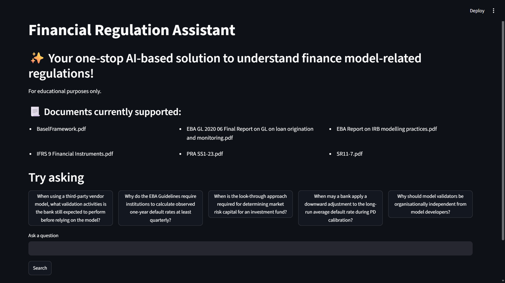
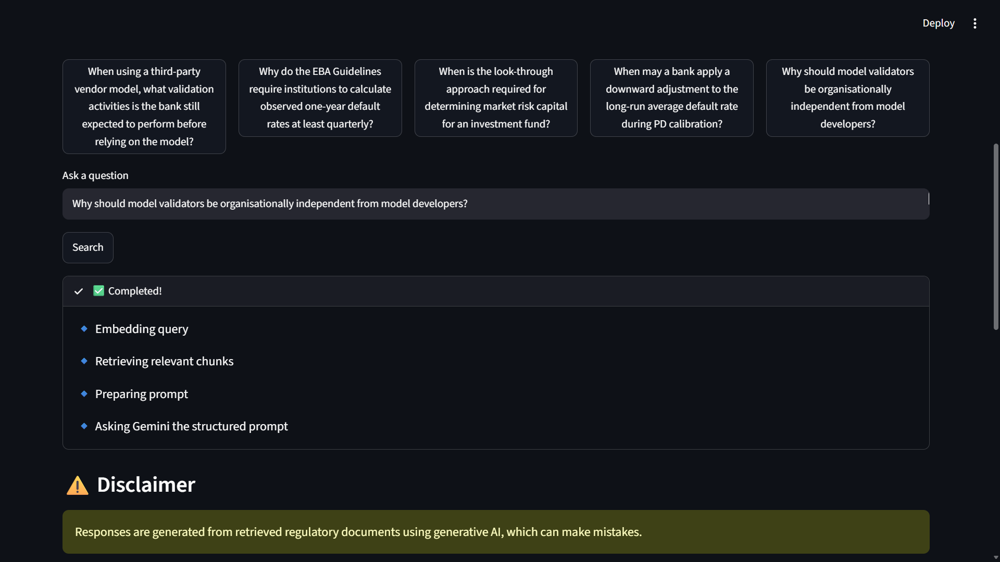
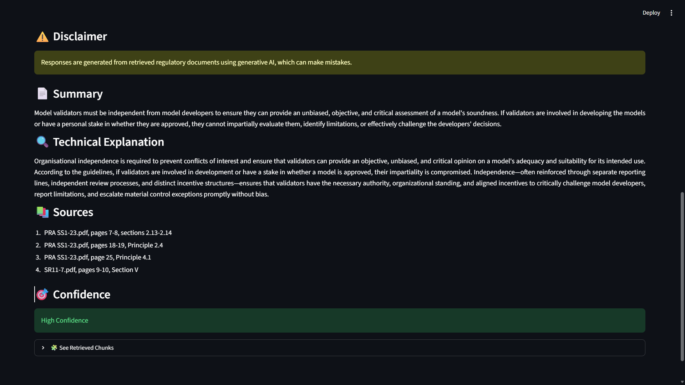
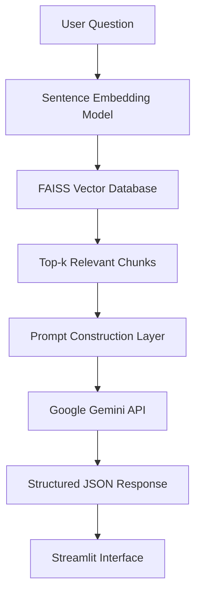

# Financial Regulation Assistant 👔

**AI-powered Retrieval-Augmented Generation (RAG) for Financial Regulations**

## 📖 Introduction

This is an AI assistant that understands thousands of pages of financial regulations and synthesizes answers across multiple regulatory documents using semantic search, Retrieval-Augmented Generation (RAG), and Google's Gemini API.

Financial regulations are rarely written in a single document. A seemingly simple question like

__"How should banks manage model risk?"__

may require information from Basel Framework, SR 11-7, PRA SS1/23 IFRS 9, EBA Reports, etc.

Traditional keyword search can retrieve individual paragraphs, but it cannot combine evidence spread across multiple regulatory documents.

This project solves that problem.

Instead of searching for exact words,

- it performs semantic retrieval over thousands of pages of financial regulations,
- identifies the most relevant sections across different documents,
- and uses an LLM to synthesize them into one coherent, grounded answer, with citations back to the original sources.

This makes it far more useful for the following individuals who need to understand regulations rather than simply locate them:

- finance professionals,
- model risk analysts,
- auditors,
- quantitative risk managers,
- and students.

## 🎯 Project Overview

Financial Regulation Assistant is a Retrieval-Augmented Generation (RAG) application that allows users to ask natural language questions about banking regulations. Unlike a generic chatbot, the assistant does not rely solely on the LLM's internal knowledge. Instead, every response is grounded in retrieved regulatory text before generation.

The application:

- 🔍 Searches semantically across multiple regulatory documents
- 🧠 Retrieves the most relevant regulatory passages
- 🤖 Uses Google Gemini to generate a grounded response
- 📚 Includes document citations for transparency
- 🧩 Allows inspection of retrieved chunks to understand why the model answered the way it did
- 🐳 Runs locally or inside Docker with a single command


## 🚀 Demo

### Search Interface



### Processing the response




### Generated Response



### Application (with Relevant Retrieved Chunks)


## ✨ Features
### 🔎 Semantic Search

Instead of keyword matching, the application converts both regulatory documents and user queries into 384-dimensional vector embeddings. This allows it to retrieve passages based on meaning, making searches much more robust.

### 📚 Multi-document Retrieval

A single answer can combine evidence from multiple regulations.

### 🤖 Retrieval-Augmented Generation (RAG)

Rather than allowing the LLM to answer directly, the application first retrieves relevant regulatory context and injects it into the prompt, along with the page numbers, section numbers and paragraph numbers. This dramatically reduces hallucinations while improving factual grounding.

### 📖 Source Citations

Every answer includes citations pointing back to the originating document. Users can verify information instead of blindly trusting AI-generated text.

### ✅ Confidence Level

The system's confidence in its answer is also displayed as ___Low/ Medium/ High___, informing the user of its credibility.

### 🧩 Retrieval Transparency

The application optionally displays every retrieved chunk used during generation. This provides an additional level of explainability.

### 🐳 Docker Support

The complete application can be deployed using Docker, eliminating dependency issues and ensuring reproducible environments.

## 🏗 System Architecture
<p align="center">


                    
</p>

## 🧠 How It Works

### Step 1 — Document Processing

Large regulatory PDFs are split into manageable text chunks. Each chunk is embedded into a dense vector representation. These vectors are stored inside a __FAISS index__ for efficient similarity search.

### Step 2 — User Query

The user's question is converted into the same embedding space.

### Step 3 — Semantic Retrieval

Instead of searching for exact keywords, FAISS retrieves the most semantically relevant chunks. These chunks may originate from completely different regulatory documents.

### Step 4 — Prompt Construction

Retrieved chunks are inserted into a carefully engineered prompt that instructs Gemini to:

- remain grounded in retrieved evidence
- generate structured JSON

### Step 5 — Answer Generation

Gemini synthesizes information across retrieved passages to produce:

- Executive Summary
- Technical Explanation
- Supporting Citations
- Confidence Level

### Step 6 — User Transparency

If enabled, users can inspect every retrieved chunk used during generation. This makes the reasoning process substantially more transparent than conventional chatbots.

## 🛠 Technology Stack
| Category | Technologies |
|----------|--------------|
|Programming Language | Python |
| Frontend | Streamlit |
| LLM | Google Gemini 3.5 Flash |
| Embeddings | Sentence Transformers (BAAI/bge-small-en-v1.5) |
| Vector Search | FAISS |
| Data Processing | PyPDF, JSON |
| Containerization | Docker |
| Version Control | Git & GitHub |

## 💡 Engineering Decisions
### Why Semantic Search instead of Keyword Search?
Financial regulations often express the same concept using different terminology.

For example, ___"qualitative models"___ and ___"judgement-based approaches"___ may refer to closely related concepts while sharing few exact words.

Semantic embeddings capture meaning instead of literal text, making retrieval significantly more robust.

### Why FAISS?

__FAISS (Facebook AI Similarity Search)__ enables extremely fast nearest-neighbor search over dense vector embeddings. Compared with brute-force similarity search, FAISS scales efficiently as the document corpus grows.

### Why Show Retrieved Chunks?

This application intentionally exposes retrieved context so users can verify:

- what information was retrieved,
- why the model answered as it did,
- and whether the retrieved evidence is sufficient.

This improves transparency and user trust.

## 🚀 Getting Started
### Prerequisites

Before running the application, ensure you have:

- Python 3.11+
- Git
- Docker (optional but recommended)
- A Google Gemini API Key

### ⚡ Installation

Clone the repository:

```
git clone https://github.com/sumantchopdata/fin_reg_ai.git
```

Move into the project directory:

```
cd fin_reg_ai
```

Create a virtual environment:

```
python -m venv .venv
```

Activate it:
```
.venv\Scripts\activate
```

Install dependencies:
```
pip install -r requirements.txt
```

### 🔑 Environment Variables

Create a .env file in the project root.

```
GEMINI_API_KEY=your_api_key_here
```

Or use Streamlit Secrets when deploying:

```
GEMINI_API_KEY="your_api_key_here"
```

### ▶️ Running the Application

Launch Streamlit:

```
streamlit run app.py
```

The application will be available at:

```
http://localhost:8501
```

### 🐳 Running with Docker

Build the Docker image:

```
docker build -t fin-reg-ai .
```

Run the container:
```
docker run -p 8501:8501 \ -e GEMINI_API_KEY=YOUR_API_KEY \ fin-reg-ai
```
Open:
```
http://localhost:8501
```

## 📄 Supported Regulatory Documents

The current knowledge base includes:

| Document | Purpose |
|---------|---------|
| Basel Framework |	Global banking regulation and capital requirements |
| SR 11-7 | Model Risk Management Principles by U.S. Federal Reserve |
| PRA SS1/23 | Model Risk Management Principles by PRA |
| IFRS 9 | Financial Instruments and Expected Credit Loss |
| EBA Report on IRB Modelling Practices	| Internal Ratings-Based modelling guidance by EBA |
| EBA Loan Origination and Monitoring | Guidance on modelling loan origination and monitoring by EBA |

The architecture is document-agnostic, making it straightforward to extend the system with additional regulatory publications.

## 💬 Example Questions

The assistant can answer questions such as:

- What are the key principles of model risk management?
- How does SR 11-7 define effective model validation?
- Compare PRA SS1/23 with SR11-7 on governance expectations.
- When should a bank use the IRB approach under Basel?
- How does IFRS 9 treat expected credit losses?
- What documentation should accompany model development?
- How should banks monitor model performance after deployment?
- What are the governance requirements for internal models?

## 🔍 Retrieval Pipeline

The application follows a classic Retrieval-Augmented Generation workflow:

- Convert user question into an embedding.
- Search the FAISS vector database.
- Retrieve the most relevant chunks.
- Inject retrieved evidence into the prompt.
- Generate a grounded answer.
- Display citations.
- Optionally expose retrieved chunks for transparency.

## 📈 Scalability

Although this project currently operates on a curated collection of financial regulations, the architecture is designed to scale. Potential extensions include:

- Additional regulatory frameworks
- Enterprise document repositories
- Internal banking policies
- Technical documentation
- Audit reports

Only the indexed document corpus needs to change, the retrieval pipeline remains the same.

## 🚧 Current Limitations

Like any RAG system, this project has limitations.

- Responses depend on the quality of retrieved chunks.
- Only currently indexed documents can be referenced.
- Retrieval quality is influenced by embedding performance.
- Very broad questions may require more retrieved context than the configured top-k value.
- Citations identify source documents, page numbers and section numbers, but could be enhanced with finer-grained chapter references.

## 🔮 Future Improvements
- Metadata-aware filtering
- Conversational memory
- PDF page previews
- Citation highlighting inside PDFs
- User feedback collection
- Evaluation framework (***Precision@k***, ***Recall@k***)
- Support for additional LLM providers
- Authentication and multi-user support, with a personalised set of documents for each user
- Cloud deployment

## 🤝 Contributing

Contributions, suggestions, and issue reports are welcome.

If you'd like to improve the project:

- Fork the repository
- Create a feature branch
- `git checkout -b feature/amazing-feature`
- Commit your changes
- `git commit -m "Add amazing feature"`
- Push the branch
- git push origin feature/amazing-feature
- Open a Pull Request

## 🙏 Acknowledgements

This project builds upon several outstanding open-source technologies and public standards.

Special thanks to:

- Google Gemini
- Streamlit
- FAISS
- Sentence Transformers
- Docker

## 👨‍💻 Author

### Sumant Chopde

📫 LinkedIn: `https://www.linkedin.com/in/sumant-chopde/`

💻 GitHub: `https://github.com/sumantchopdata`